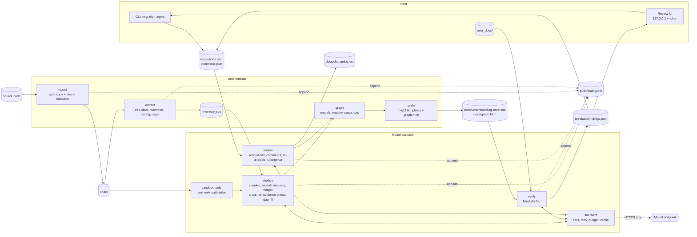
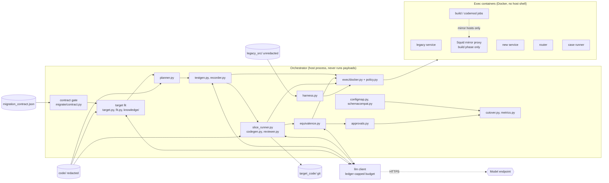

# Architecture

Parity migrates a legacy app to the newest version of its stack, or to a different technology, and proves the
new app behaves like the old one. The migration has five steps (understand, approve, migrate, prove, cut over); the
components below implement them. Phase 1 (understand, approve) is the foundation every later step points back to, and
Phase 2 (migrate, prove, cut over) is what delivers the migrated app.

## Goals and constraints

1. **Evidence or it did not happen.** Every graph node and edge carries file/line/quote evidence that is checked
   against the real source; confidence is *derived* from evidence, never asserted by the model.
2. **Read-only and non-executing (Phase 1).** The source is copied once; nothing is run; the model has a jailed
   read-only tool set. Phase 2 runs code, but only inside isolated exec containers (section "Phase 2" below).
3. **The folder is the state.** One project folder holds all inputs, intermediate results and outputs, so a run
   can be resumed, diffed, backed up and audited with ordinary tools.
4. **Independent verification.** The Verifier sees documentation and the generated document, never the code.
5. **Human in the loop.** Findings feed a review/resolve cycle that re-analyses only what is disputed.

## Component diagram



## Data flow

1. `init` creates the folder and `project.json`.
2. **ingest** normalises the source into `code/` and writes `ingest_report.json`.
3. **extract** parses with tree-sitter and manifest/config parsers. Output: `facts/*.json` and `inventory.json`,
   the checklist of everything that must be explained (files, routes, config keys, dependencies).
4. **analyze**
   1. `chunker` splits the code into token-bounded chunks along structural boundaries and plans cost.
   2. `module_analyzer` asks the model (task `chunk_extract`) for a *patch* (nodes/edges with evidence) per chunk;
      patches are persisted in `checkpoint/` so an interrupted run resumes.
   3. `merger` combines patches, allocating stable IDs through `graph/registry.json`.
   4. `crossref` resolves references that span chunks, using the read-only tools.
   5. `rules` extracts business rules; `gapfill` revisits inventory items that nothing mapped.
   6. `evidence.verify_evidence` re-checks every quote against `code/`; failing claims are rejected or demoted.
   7. `coverage` computes the inventory coverage matrix.
   8. `graph.store.save_snapshot` writes `graph/snapshots/vNNN.json` and `graph/latest.json`; `render` produces the
      document and `viz` the interactive `graph.html`.
5. **verify** extracts claims from the document and from `user_docs/`, compares them, drops findings whose quotes
   do not occur verbatim, writes `feedback/findings.json`.
6. **review / resolve** record `resolutions.json` and `comments.json`; `review.reanalyze` re-reads only the code around
   the affected nodes, merges a new snapshot, marks feedback processed and `review.changelog` writes
   `docs/changelog.md` from snapshot diffs.

## Trust boundaries

| Boundary | Control |
|---|---|
| Source -> project | `ingest`: archive validation, size limits, no execution, secret withholding/redaction |
| Project -> model | Only `code/` content via jailed tools and prompts; secrets already redacted; text from code, docs and reviewers wrapped in non-forgeable delimiters and treated as data |
| Model -> graph | Strict pydantic models (`extra="forbid"`); evidence verified against real files; IDs allocated by the registry, not the model |
| User docs <-> code | The Verifier never receives code; analysis never receives user docs |
| Process -> network | Optional in-process guard; in Docker, `network_mode: none` or an `internal` network whose only exit is an allowlisting Squid proxy |
| Reviewer -> project | Loopback-only server, token, Host/Origin checks, narrow write API (comments, resolutions, decisions, approval; Phase 2 routes in [api-reference.md](api-reference.md) section 5) |

## Key design decisions

* **Derived confidence** (`graph.models.derive_confidence`): `high` needs two strongly evidenced items (line range or
  symbol plus a verbatim quote); `medium` one, or several weak ones; `low` one weak; `none` no evidence.
* **Stable IDs**: `Registry` maps `(type, module, symbol)` to an ID for the life of the project so snapshots diff cleanly.
* **Snapshots, not mutation**: graph versions are immutable files; `latest.json` is a pointer (no symlinks), so
  diffs, changelogs and rollbacks are trivial.
* **Budget and cache**: `Budget` is checked before every call using a token estimate; `llm_cache/` is keyed by
  model, system, prompt and prompt version; the audit log records tokens and USD per call.
* **Atomic writes** (temp file + `os.replace`) for all feedback and graph files; audit appends use `O_APPEND` plus `flock`.
* **Model-agnostic**: `LLMClient` is a one-method protocol; LiteLLM implements it, `OfflineLLM` and `FakeLLM` stand in for tests and `--offline`.
* **Container is the boundary**; the in-process guard is a tripwire. See `src/migration_agent/sandbox/README.md`
  for what it does and does not stop.

## Module map

| Package / module | Role |
|---|---|
| `cli.py` | Click entry point, `.env` loading |
| `project.py` | Folder layout, metadata |
| `ingest/` | Safe copy, secret scanning/redaction |
| `extract/` | tree-sitter AST facts, manifests, config keys, static dependencies |
| `pipeline.py` | Inventory, facts-only graph, minimal doc |
| `analyze/` | LLM analysis pipeline and prompts (`analyze/prompts/*.md`) |
| `graph/` | Models, ID registry, snapshot store and diffs |
| `llm/` | Client protocol, LiteLLM adapter, offline stand-in |
| `verify/` | User-doc conversion, blind Verifier, contracts (`verify/models.py`) |
| `review/` | Resolutions, comments, targeted re-analysis, changelog |
| `review_ui/` | Local HTTP server and single-page UI |
| `render.py`, `templates/` | Understanding document |
| `viz/` | Standalone interactive graph page |
| `sandbox/` | Read-only tools, process guard |
| `audit.py` | JSONL audit log |
| `config_env.py` | `MA_*` environment configuration |
| `evalharness.py`, `eval/` | Scoring against hand-labelled reference repos |
| `migrate/` | Phase 2: contract gate, target fit, planner, characterization tests, exec sandbox, harness, generation loop, equivalence, approvals, config/schema, router, cut-over, metrics ([phase2-architecture.md](phase2-architecture.md)) |
| `service.py` | Library API for hosts (`run_stage` for Phase 1 and Phase 2 stages) |

## Known limits

Static extraction supports the languages tree-sitter-language-pack covers; unsupported or unparsable files
are marked `parse_status: fallback` (listed in the document). The model sees only chunks and tool results; behaviour that
exists only at runtime (reflection, generated code, data in databases) shows up as blind spots, not facts.

## Phase 2: migrate and prove equivalence

Phase 2 starts from the approved migration contract (`docs/migration_contract.json`) and produces a new service in
`target_code/`, with evidence that it behaves like the legacy service. Detailed module map and public functions:
[phase2-architecture.md](phase2-architecture.md). Plan and decisions: [phase2-plan.md](phase2-plan.md). Threat
model: [threat-model.md](threat-model.md) section 9.

Status: implemented (M0 to M7) and tested offline with a scripted docker CLI and fake model clients. It has run on a
real Docker daemon on the eval fixtures, with `--offline` (no model); it has not run with a real model. See
[remaining-work.md](remaining-work.md).

### Components



The model calls (`target_fit`, `test_gen`, `plan` naming, `codegen`, `code_review`, `equiv_triage`) happen in the
orchestrator. The model has no exec or network tools (decision P2-Q6): it returns structured edits or findings, and
the orchestrator validates them. Containers have no model access.

### Data flow

1. **Gate.** Every writing command calls `require_contract`: graph and doc hashes, graph version, `source_hash`,
   decisions for every quirk, coverage. Deferred findings become slice blockers.
2. **Target fit.** `target init` writes `target/target.yaml`; `target fit` writes `target/fit_report.json|md`.
3. **Plan.** `plan` condenses the approved graph into ordered slices (`plan/migration_plan.json`), each node in exactly
   one slice; slice states start at `planned`.
4. **Harness.** `harness import-source` copies the original source into `legacy_src/` after a hash check;
   `harness build|up --legacy` builds and starts it in the sandbox.
5. **Characterization.** `tests generate` writes case inputs; `tests record --harness` runs each case twice against
   legacy and stores the expected output with noise masks; slices move to `tests_recorded`.
6. **Generation.** `generate` runs the per-slice loop: context pack -> model edits -> validation -> commit -> build
   job -> unit tests + characterization suite against the new service (in-network) -> review -> `awaiting_human`.
7. **Equivalence.** `equivalence` runs the slice's cases and earlier approved slices' cases against both services
   and classifies diffs; regressions become fix requests for the next generation run.
8. **Approval.** `approve-slice` checks the gate and tags `slice/SLICE-NNNN/approved`. In strangler mode,
   `harness flip` routes the slice's endpoints to the new service and `equivalence composite` re-runs the suite.
9. **Config and schema.** `config map` and `config schema-check` must leave no open items.
10. **Cut-over.** `cutover` checks readiness and writes `cutover/plan.md`; `--approve` writes
    `cutover/approval.json` with hashes of everything it approved.

### Folder layout v2

Phase 2 folders are created on first write and bump `project.json` `schema_version` from 1 to 2:

```
<project>/
  docs/migration_contract.json   Phase 1 output, read-only for Phase 2
  legacy_src/                    original unredacted source; mounted only into exec containers
  inputs/traffic/                optional recorded requests
  target/  plan/  characterization/  harness/  target_code/  slices/  runs/
  migration/  config/  data/  equivalence/  cutover/
```

Contents per folder: [user-guide.md](user-guide.md) section 9.4 and
[phase2-architecture.md](phase2-architecture.md) ("Folder layout").

### Trust boundaries (Phase 2)

| Boundary | Control |
|---|---|
| Contract -> Phase 2 | `require_contract` on every writing command; stale or mismatched contracts are refused |
| Original source -> `legacy_src/` | `harness import-source` verifies the contract `source_hash`; credential files stay withheld |
| `legacy_src/` -> model | Not possible by construction: agent tools are rooted at `code/`; `legacy_src/` is only a container mount |
| Orchestrator -> exec container | Fixed argv, `shell=False`; `exec/policy.py` checks every job and argv (no socket, no privileged flags, project-relative mounts only, no secret env); images run by local ID, never pulled |
| Exec container -> network | Test phase: `--network none` or an `--internal` network. Build phase: `--internal` network plus Squid allowing only mirror hosts; no hosts means no network |
| Exec container -> orchestrator | Results are files: logs capped and redacted, reports copied without following symlinks, tails fed to a model only delimited and neutralised |
| Model -> `target_code/` | Edits validated by `codegen.prepare_changes`: path jail, build-file allowlist, exact search/replace, secret scan, dependency allow/deny; then a fresh-session review plus static deny checks |
| `target_code/` git | Fixed argv, hooks disabled (`core.hooksPath=/dev/null`), no global or system config |
| Human -> approvals | CLI, or the review server (loopback, token, Host/Origin checks); slice and cut-over approvals record hashes and become stale when inputs change |
| Hosted platform | Phase 2 is CLI/self-hosted only (P2-Q13); the hosted worker does not run exec |
