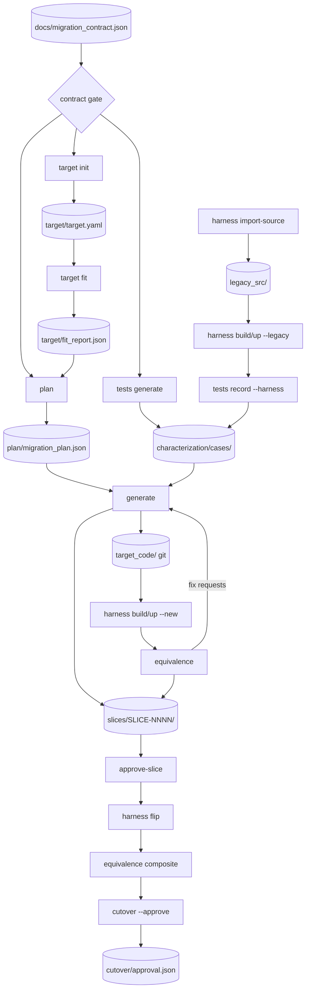

# Phase 2 architecture: the `migrate/` package

Companion to [phase2-plan.md](phase2-plan.md) (the agreed plan, decisions in its section 14). This page describes
the code as it is: the module map, the public functions, the shared contracts, and how to add commands. User-level
instructions are in [user-guide.md](user-guide.md) section 9; security controls in
[threat-model.md](threat-model.md) section 9.

Status: milestones M0 to M7 are implemented and tested offline (unit and integration tests with a scripted docker
CLI and fake model clients). They have also run on a real Docker daemon on the eval fixtures, without a model: see
the "Implementation status" section at the top of the plan and [remaining-work.md](remaining-work.md) for what has and
has not run live.

## Module map

All Phase 2 code lives in `src/migration_agent/migrate/`. Each module's docstring is the detailed reference.

| Module | Milestone | Commands | Purpose |
|---|---|---|---|
| `__init__.py` | M0 | | Import-free on purpose: the top-level CLI imports `migrate.cli` at start-up |
| `cli.py` | M0 | `contract check`, `contract schema`, `doctor` | `register(main)`: creates the groups, imports every module in `SUBMODULES` |
| `models.py` | M0 | | Shared pydantic contracts (below). Change only additively |
| `ids.py` | M0 | | `SLICE-`/`CT-`/`RISK-`/`EQ-`/`RUN-` allocator in `migration/ids.json` (flock + atomic replace) |
| `paths.py` | M0 | | `Phase2Layout(project)`: every Phase 2 path as a property; `ensure()` creates folders lazily |
| `state.py` | M0 | | Atomic JSON I/O, `sha256_file`, `file_lock`, slice state machine (`transition`) |
| `contract.py` | M0 | | Entry gate: `load_contract`, `check_contract`, `require_contract`, `contract_json_schema` |
| `ledger.py` | M0 | | Cumulative spend from `audit/audit.jsonl`: `spent`, `remaining`, `budget_for`, `project_budget_usd` |
| `exec/base.py` | M0 | | `ExecBackend` protocol, `record_run` (writes `runs/RUN-NNNN/`), `load_run`, `UnavailableBackend` |
| `exec/fake.py` | M0 | | `FakeExecBackend` + `FakeOutcome` for tests |
| `exec/__init__.py` | M0 | | `get_backend(project)` |
| `exec/docker.py` | M1 | | `DockerBackend`: fixed-argv `docker run`, two-phase network, limits, gVisor, mirror proxy; `load_exec_config` |
| `exec/policy.py` | M1 | | `scan_job`/`check_job`, `scan_argv`/`check_argv`: static checks before every container |
| `harness.py` | M1, M6 | `harness import-source|build|up|down|status|flip|unflip|routes` | Harness spec, legacy/new/composite roles, strangler route table, in-network case runs |
| `target.py` | M2 | `target init`, `target show` | `TargetSpec` from manifests + flags: `detect_source`, `build_spec`, `load_target`, `write_target` |
| `fit.py` | M2 | `target fit`, `target resolve` | Deterministic libmap layer + verified model layer; `fit_blockers` gates the planner |
| `knowledge/` | M2 | | `load_libmaps()`; tables in `knowledge/libmap/*.yaml` (java8-21, spring-boot2-3, django3-5, express-fastify, js-go) |
| `casestore.py` | M3 | | Case files, hypotheses, untestable marks, scope (`scope_nodes`), `load_plan` |
| `testgen.py` | M3 | `tests generate`, `tests approve-spec` | Proposes case inputs (model or offline proposer); never expected values for preserved behaviour |
| `recorder.py` | M3 | `tests record`, `tests run`, `tests coverage`, `tests mark-untestable` | Double recording against legacy, noise masks, runtime findings, coverage gate `coverage_gaps` |
| `harness_runner/` | M3 | | Language-neutral case runner: origin jail, compare, JSONPath masks, stub server, stdlib-only in-network runner |
| `planner.py` | M4 | `plan` | Approved graph -> ordered slices (`build_plan`, `plan_project`) |
| `targetrepo.py` | M4 | | `target_code/` as a hardened local git repo: `init_repo`, `commit_iteration`, `diff`, `human_commits` |
| `codegen.py` | M4 | | Edit schema, path jail, build-file allowlist, exact apply, secret scan, dependency check, context pack |
| `reviewer.py` | M4 | | Fresh-session `code_review` task plus deterministic static deny checks |
| `codemods/` | M4 | | `run_codemods`; adapters: OpenRewrite (Maven and Gradle), django-upgrade + pyupgrade, lebab (JavaScript); optional per-adapter `image_for(spec)` and `cache` (mounted at `/cache`) |
| `slice_runner.py` | M4 | `generate` | Per-slice loop: context -> codegen -> apply -> commit -> build -> tests -> review -> human |
| `equivalence.py` | M5, M6 | `equivalence [run]`, `equivalence composite`, `equivalence approve-mask` | Legacy vs new diffs, classification, triage, fix requests, masks, composite runs |
| `differential.py` | M5 | `equivalence fuzz` | Latency summary (p50/p95, slower cases) recorded by every equivalence run; differential fuzzing of recorded HTTP cases (deterministic mutations, legacy asked twice to mask noise); both advisory |
| `approvals.py` | M5 | `approve-slice`, `reject-slice`, `slice comment|decide|accept-observed` | Comments, slice decisions, git inspection, approval gate `approval_blockers` |
| `configmap.py` | M6 | `config map`, `config set` | Config keys -> target convention; secrets as references only |
| `schemacompat.py` | M6 | `config schema-check`, `config schema-blockers` | Legacy schema vs what the new service expects; declared expand/contract changes; blind spots |
| `router/` | M6 | | Package data: stdlib reverse proxy (`proxy.py`), `schema_probe.py`, `Dockerfile` |
| `cutover.py` | M7 | `cutover [--approve]` | Readiness gate, deterministic `cutover/plan.md`, `cutover/approval.json` with hashes |
| `metrics.py` | M7 | `metrics` | `compute_metrics(project)`: derived from existing files only |
| `supplychain.py` | M7 | | Per-build lockfile sha256 hashes, build-generated-lockfile and unpinned-dependency warnings, CycloneDX SBOM; written by `harness build`, read by `cutover` |
| `prompts/` | M2-M5 | | `target_fit.md`, `test_gen.md`, `plan.md`, `codegen.md`, `codegen_fix.md`, `code_review.md`, `equiv_triage.md` |

Outside `migrate/`: `service.py` (Phase 2 stages for `run_stage`, `metrics()`), `review_ui/server.py` and `page.py`
(Target fit, Plan, Slice and Comments tabs, `/api/p2/*` routes), `evalharness.py` (`score_migration`,
`compare_migration`, `run_phase2_offline`), `scripts/eval_phase2.py` (CI gate), `eval/targets/` (target pairs) and
`eval/repos/*/harness/` (runnable fixtures).

Phase 1 changes made for Phase 2: `analyze/runner.py` persists gap-fill exclusions (`facts/coverage_exclusions.json`);
readiness, approval, `review/docrender.py` and `review/reanalyze.py` compute coverage with
`analyze/coverage.project_coverage`; `MigrationContract` (in `verify/models.py`) gained `source_hash` (schema 2);
`project.py` `SCHEMA_VERSION = 2`; `cli.py` has one registration line.

## Data flow



Every command that writes Phase 2 state calls `require_contract` first. The model sees only the redacted `code/`,
graph facts and generated text; `legacy_src/` is mounted only into exec containers.

## Public entry points

```python
from migration_agent.migrate.contract import check_contract, require_contract   # ContractCheck / MigrationContract
from migration_agent.migrate.ledger import budget_for                            # Budget capped by project budget
from migration_agent.migrate.target import detect_source, load_target            # Detection / TargetSpec
from migration_agent.migrate.fit import run_fit, resolve_risk, fit_blockers      # FitRun / FitResolution / [Risk]
from migration_agent.migrate.planner import plan_project, build_plan             # PlanResult / PlanDraft
from migration_agent.migrate.testgen import generate_cases, approve_spec         # TestgenReport
from migration_agent.migrate.recorder import record_cases, run_suite, coverage_gaps
from migration_agent.migrate.harness import import_source, build, up, down, status, flip, unflip, run_cases_in_network
from migration_agent.migrate.slice_runner import generate, dry_run, GenerateOptions   # GenerateReport
from migration_agent.migrate.equivalence import run_equivalence, run_composite, approve_mask
from migration_agent.migrate.approvals import approve_slice, reject_slice, approval_blockers, add_comment
from migration_agent.migrate.configmap import build_config_map, config_gaps, set_decision
from migration_agent.migrate.schemacompat import check, schema_blockers
from migration_agent.migrate.cutover import readiness, write_plan, approve, verify_approval
from migration_agent.migrate.metrics import compute_metrics
```

Signatures (keyword-only arguments shown after `*`):

| Function | Signature (abridged) |
|---|---|
| `run_fit` | `(project, llm=None, *, pin=False, accept_unmapped=False, log=None, ...) -> FitRun` |
| `plan_project` | `(project, *, dry_run=False, offline=False, include_dead_code=False, ...) -> PlanResult` |
| `generate_cases` | `(project, llm=None, *, offline=False, node_ids=None, ...) -> TestgenReport` |
| `record_cases` | `(project, base_url=None, second_base_url=None, *, ...) -> RecordReport` |
| `harness.build` / `up` / `down` / `status` | `(project, role="legacy", *, backend=None) -> dict` |
| `harness.flip` | `(project, slice_id, *, force_for_testing=False, actor="human", reason="") -> dict` |
| `run_cases_in_network` | `(project, role, cases, *, backend=None, compare=True, timeout_s=10.0, ...)` |
| `slice_runner.generate` | `(project, *, slice_id=None, all_slices=False, llm, backend=None, ...) -> GenerateReport` |
| `run_equivalence` | `(project, slice_id, legacy_url=None, new_url=None, *, llm=None, ...) -> EquivalenceReport` |
| `run_composite` | `(project, *, base_url=None, backend=None, timeout_s=10.0, ...) -> CompositeReport` |
| `approve_slice` | `(project, slice_id, by, note="") -> SliceApproval` (raises `ApprovalError` with `.blockers`) |
| `build_config_map` | `(project, *, force=False) -> ConfigMap` |
| `schemacompat.check` | `(project, *, backend=None, static=False, ...) -> SchemaCompatReport` |
| `cutover.readiness` / `approve` | `(project) -> Readiness` / `(project, by, note="") -> CutoverApproval` |
| `compute_metrics` | `(project) -> dict` (pure read; missing data is `None`, never 0) |

For hosts that embed the engine, `migration_agent.service.run_stage` wraps the main steps (see
[platform-contract.md](platform-contract.md) section 2).

## Shared contracts (`migrate/models.py`)

All models use `extra="forbid"` and round-trip through `model_dump_json` / `model_validate_json`. Sha256 fields accept
64 lowercase hex chars or `""` (not known yet).

| File | Model | Plan |
|---|---|---|
| `docs/migration_contract.json` | `verify.models.MigrationContract` (single definition; never fork it) | 1 |
| `target/target.yaml` | `TargetSpec` (`SourceStack`, `TargetStack`, `Infra`, `Style`, `Libraries`, `EquivalencePolicy`); `from_yaml`/`to_yaml` | 2 |
| `target/fit_report.json` | `FitReport` of `Risk` | 2 |
| `plan/migration_plan.json`, `plan/versions/vNNN.json` | `MigrationPlan` of `Slice` (validator: unique slice ids, known `depends_on`, each node in at most one slice) | 3 |
| `slices/SLICE-NNNN/state.json` | `SliceState` + `StateTransition` (write only through `state.transition`) | 5.1 |
| `characterization/cases/SLICE-NNNN/CT-NNNN.json` | `CharacterizationCase` (`CaseSetup`, request by kind: `HttpRequest` for http/replay, `GrpcRequest`, `JobRequest`, `MessageRequest`; `Expectation` recorded/specified; `Provenance`) | 4.2 |
| `runs/RUN-NNNN/meta.json` | `{"job": ExecJob, "result": ExecResult}` (`Mount`, `Limits`) | 6 |
| `slices/SLICE-NNNN/equivalence.json` | `EquivalenceReport` of `EquivalenceDiff` (`match`/`intended_divergence`/`noise`/`regression`/`unknown`; triage `legacy_bug`/`new_bug`/`harness_issue`/`spec_ambiguity`) | 7 |
| `slices/SLICE-NNNN/approval.json` | `SliceApproval` | 8 |
| `cutover/approval.json` | `CutoverApproval` | 8 |
| `migration/runtime_findings.json` | `RuntimeFindingsFile` of `RuntimeFinding` (uses `EQ-` ids) | 4.5 |

Module-local models (not shared): `FitResolutionsFile` (fit.py), `PlannerReport` (planner.py), `RecordReport`,
`CoverageReport`, `RunReport` (recorder.py), `CodegenOutput`, `ContextPack` (codegen.py), `ReviewResult`
(reviewer.py), `EquivalenceRunMeta`, `FixRequestsFile`, `MasksFile`, `CompositeReport` (equivalence.py),
`P2CommentsFile`, `SliceDecisionsFile` (approvals.py), `ConfigMap`, `ConfigDecisions` (configmap.py),
`SchemaChangesFile`, `MappingFile`, `SchemaCompatReport` (schemacompat.py), `Readiness` (cutover.py),
`HarnessSpec` (harness.py), `ExecConfig` (exec/docker.py).

Model rules worth knowing:
- `CharacterizationCase`: `expect.source == "specified"` only with `decision == "fix"`; the request shape must match
  `kind`. A specified expectation gates a slice only once `expect.approved_by` is set (`tests approve-spec`).
- `ExecJob`: `command` is argv; phase `test` requires network `none`; `env` values that look like secrets (ingest
  secret patterns) are rejected, use `synthetic_secrets`; mount sources are project-relative without `..`, mount
  targets absolute container paths.

## ID prefixes (`migrate/ids.py`)

Format `PREFIX-NNNN` (4+ digits), never reused or renumbered, stored in `migration/ids.json`.

| Prefix | Meaning | Typical key |
|---|---|---|
| `SLICE` | migration slice | sorted node ids of the slice (re-planning the same nodes keeps the id) |
| `CT` | characterization test case | `<target>/<category>/<title-slug>` |
| `RISK` | target-fit risk | `kind:item_ids` |
| `EQ` | equivalence diff or runtime finding | `eq:<case_id>/<field>`, `runtime:<CT>:<kind>` |
| `RUN` | one sandbox exec run or one recording pass | none (sequential) |

Phase 1 IDs (`COMP-`, `EP-`, `RULE-` ..., `F-` findings, `CM-` comments) keep their own registries. Phase 2
comments in `migration/comments.json` also use `CM-` ids, in their own sequence.

## Folder layout (`migrate/paths.py` and module outputs)

Nothing is created by `Project.init`; folders appear on first write through `Phase2Layout.ensure()` (which also bumps
`project.json` `schema_version` 1 -> 2). v1 projects load unchanged; `Project.load` refuses schema versions newer than
it supports.

```
<project>/
  docs/migration_contract.json   Phase 1 output, read-only for Phase 2
  legacy_src/                    ORIGINAL unredacted source (harness import-source); exec containers only
  inputs/traffic/                optional recorded requests
  target/                        target.yaml, fit_report.json|md, fit_resolutions.json
  plan/                          migration_plan.json|md, versions/vNNN.json, planner_report.json
  characterization/              cases/SLICE-NNNN|UNPLANNED/CT-NNNN.json, fixtures/, stubs/, hypotheses.json,
                                 untestable.json, testgen_report.json, coverage.json,
                                 recordings/RUN-NNNN/, results/RUN-NNNN/
  harness/                       harness.yaml, mirror.json (optional), state.json, compose.<role>.yml,
                                 legacy_src.json, synthetic_secrets.json (0600), logs/, cache/, new/Dockerfile,
                                 router/ (build context + live/routes.json), routes.json, flips.json
  target_code/                   the new service, a git repo (agent and human commits; tags slice/SLICE-NNNN/iter-K,
                                 slice/SLICE-NNNN/approved, codemod/<name>/RUN-NNNN)
  slices/SLICE-NNNN/             state.json, loop.json, iterations/K/{prompt_meta,edits,build,tests,review,outcome}.json,
                                 review.json, decisions.json, equivalence.json, equivalence_run.json,
                                 fix_requests.json, approval.json
  runs/RUN-NNNN/                 meta.json, logs/stdout.txt|stderr.txt, reports/, work/, codemod.patch
  migration/                     ids.json, comments.json, runtime_findings.json, codemods.json, contract.schema.json
  config/                        config_map.json|md, decisions.json, generated/
  data/                          schema_changes.yaml, mapping.yaml, schema_compat.json|md (optional inputs + report)
  equivalence/                   report.md, masks.json, composite.json, composite_history.jsonl, composite_run.json
  cutover/                       plan.md, approval.json, hashes.json
```

The plan's `tests/` folder is named `characterization/` so it is not confused with a repository's own tests.
Methods taking ids (`slice_dir`, `case_file`, `run_dir` ...) validate them, so a crafted id cannot escape the folder.
Write files with `state.atomic_write_json` / `atomic_write_text` (they create parent folders); call
`layout.ensure(dir)` once for the folder so the schema bump happens.

## Entry gate and budget

- `require_contract(project, pin=..., accept_unmapped=...)` returns the `MigrationContract` or raises
  `ContractError` (with `.check`). `check_contract` returns `ContractCheck{ok, errors, warnings, blockers,
  graph_version, latest_graph_version, contract_sha256, pinned}` and implements plan section 1 rules 1-7 (listed in
  `contract.py`). `blockers` lists deferred findings (`finding_id`, `item_ids`); the planner attaches them to slices.
- Model calls get their budget from `ledger.budget_for(project, spec.budget_usd, max_usd=cli_max_usd)`: an
  `llm.litellm_client.Budget` capped at the remaining project budget (sum of `llm_call` audit records), so caps hold
  across sessions. The slice runner tags model calls with `slice=SLICE-NNNN` (`TaggedAudit`); `Ledger.by_slice`
  gives per-slice spend, checked before every call against `--max-usd-per-slice`.

## Slice state machine (`migrate/state.py`)

```
planned -> tests_recorded -> generating -> built -> tests_passing -> reviewed -> awaiting_human -> approved | rejected
fix loop: built | tests_passing | reviewed | awaiting_human -> generating   (iteration += 1; generating -> generating too)
rejected -> generating | planned        approved -> generating (reopen, e.g. human commit)
any except approved -> blocked (reason required); blocked -> the status it came from | planned
```

`transition(project, slice_id, to_status, actor=..., reason=...)` validates (raises `IllegalTransition`), locks,
writes atomically and audits (`slice_runner` / `slice_transition`). `Slice.status` in the plan is only a mirror.

## Gates

| Gate | Function | Used by |
|---|---|---|
| Contract | `contract.require_contract` | every writing command |
| Fit blockers | `fit.fit_blockers` (open high-severity risks) | `plan` |
| Coverage | `recorder.coverage_gaps` | `tests coverage --fail-on-gaps`, `cutover` |
| Slice approval | `approvals.approval_blockers` (build and suite green, no regression/unknown diff, HEAD unchanged since the equivalence run, blockers accepted, no open decisions, no pending fix requests, specified expectations approved) | `approve-slice`, review UI |
| Flip | `harness.slice_approved` (or `--force-for-testing`, audited) | `harness flip` |
| Config | `configmap.config_gaps` | `cutover` |
| Schema | `schemacompat.schema_blockers` + schema-compat report status | `cutover` |
| Cut-over | `cutover.readiness` (contract, plan, slices, equivalence, full suite on HEAD, clean target_code, coverage, config, schema, findings, budget) | `cutover`, `cutover --approve` |

## CLI registration pattern (`migrate/cli.py`)

`cli.py` has one line: `from .migrate.cli import register as _register_phase2; _register_phase2(main)`.
`register(main)` creates the groups `contract`, `target`, `tests`, `harness`, `config`, adds the M0 commands
(`contract check`, `contract schema`, `doctor`), then imports each name in `SUBMODULES` and calls its
`register(groups)`. Listed names: `target, fit, planner, harness, testgen, recorder, slice_runner, codegen,
equivalence, approvals, configmap, schemacompat, cutover, metrics`. Top-level verbs (`plan`, `generate`,
`equivalence`, `approve-slice`, `reject-slice`, `slice`, `cutover`, `metrics`) go on `groups.main`. A missing module is
skipped; an import error inside an existing module propagates. Keep heavy imports inside command functions.

```python
def register(groups) -> None:            # groups.main / .contract / .target / .tests / .harness / .config
    @groups.target.command("fit")
    @click.argument("project", type=click.Path(exists=True, path_type=Path))
    def fit_cmd(project: Path) -> None:
        from .contract import require_contract   # heavy imports inside the command
        ...
```

## ExecBackend contract (`migrate/exec/`)

```python
class ExecBackend(Protocol):
    name: str
    def available(self) -> tuple[bool, str]: ...    # cheap, no side effects (used by `doctor`)
    def run(self, job: ExecJob) -> ExecResult: ...  # never raises for job failures
```

- One job = one disposable container; `job.command` is argv.
- Network: `none` (mandatory for `test`), or `mirror` (`build` only: per-run `--internal` network plus a Squid proxy
  that allows only the configured mirror hosts; no hosts configured means `--network none`).
- Limits from `job.limits` (cpus, memory_mb, pids, timeout_s, disk_mb), plus cap_drop ALL, no-new-privileges,
  non-root, read-only rootfs + tmpfs, no docker socket, `--runtime runsc` when installed or required.
- Images are never pulled (`--pull never`); they are resolved locally and run by image ID.
- No secrets: validated `env`; `synthetic_secrets` filled with fresh random values per run.
- `exec/policy.py` checks the job and the final argv before every start.
- Results are files under `runs/RUN-NNNN/` written by `record_run` (1 MB log cap, redaction, audit record
  `exec`/`exec_run`).
- `get_backend(project)` returns `DockerBackend(project)`. Tests inject `FakeExecBackend` by monkeypatching
  `migration_agent.migrate.exec.get_backend`.

Configuration: `harness/mirror.json` `{"hosts": [...], "ports": [443], "runtime": "auto", "proxy_image": ...,
"user": "auto"}`; `MA_MIRROR_HOSTS` (comma separated) overrides `hosts`; `MA_EXEC_RUNTIME` (`auto|runsc|runc`)
overrides `runtime`.

## Tests

Helpers: `tests/phase2_helpers.approved_project(tmp_path, tmp_path_factory)` gives an offline-analysed, approved
express-crud project (built on `tests/phase1_helpers.py`); `p2_exec_helpers.py` (scripted docker CLI),
`p2_m3_helpers.py`, `p2_m4_helpers.py`, `p2_m5_helpers.py`, `p2_integration_helpers.py`.

Per module: `tests/test_p2_<module>.py` (contract, models, ledger, state, cli, target, fit, planner, testgen,
recorder, harness, harness_runner, exec_docker, codegen, codemods, reviewer, slice_runner, equivalence, approvals,
configmap, schemacompat, router, cutover, metrics, review_ui, service_stages, eval, integration) and
`tests/redteam/test_p2_exec_sandbox.py`. Live tests in `test_p2_exec_docker.py`, `test_p2_router.py` and
`test_p2_integration.py` skip when `docker info` fails and run against the real daemon otherwise. `test_p2_live_e2e.py` is the
opt-in end-to-end trial (`MA_LIVE_E2E=1`); `test_p2_differential.py`, `test_p2_supplychain.py` and `test_p2_seed.py` cover
fuzzing and latency, lockfiles and the SBOM, and request headers and seeds.
