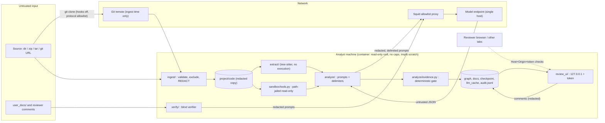

# Threat model (D-06)

Scope: the `migration-agent` CLI, its project folder, the ingestion engine, the analysis/verification
pipeline, the local review server, and the container sandbox. Verified by the red-team suite in
`tests/redteam/` (fixtures built at test time by `scripts/make_redteam.py`; inert payloads in
`eval/redteam/payloads.json`). Run: `PYTHONPATH=src .venv/bin/python -m pytest -q tests/redteam`.

## 1. Assets

| Asset | Why it matters |
|---|---|
| Customer source code and its history | Proprietary IP; must only leave the machine as redacted prompt text to the one model endpoint. |
| Credentials embedded in the customer repo (cloud keys, tokens, DB passwords, private keys) | Highest-impact leak: must never reach a prompt, trace, cache, checkpoint, graph, doc or review UI. |
| Operator credentials (`ANTHROPIC_API_KEY` in env/`.env`) | Spend and account abuse. Never written to disk by the tool; scrubbed from audit free text if echoed. |
| Integrity of the knowledge graph / understanding doc | Wrong or attacker-authored "facts" mislead a migration. Every claim must carry verifiable evidence. |
| Host filesystem and network of the analyst's machine | Must not be readable/writable/reachable through repo content. |
| Review state (`feedback/*.json`, token) | Reviewer decisions drive re-analysis; token grants write access to the UI. |

## 2. Actors

| Actor | Capability |
|---|---|
| A1 Malicious repo author | Controls every byte of the source (files, names, comments, archives, git metadata). Primary adversary. |
| A2 Hostile model output / prompt-injected model | Returns arbitrary JSON; may try to cite files outside the repo or invent graph items. |
| A3 Malicious web page in the reviewer's browser | Can make cross-origin requests to `127.0.0.1`, attempt DNS rebinding and CSRF. |
| A4 Malicious or careless user-doc author | Pastes credentials or injection text into `user_docs/` or review comments. |
| A5 Network observer / compromised dependency | Watches or redirects egress. Partly out of scope (see residual risks). |
| A6 Co-resident local user | Reads project folders or the review port. Out of scope beyond loopback binding and a per-run token. |

## 3. Trust boundaries

Boundaries that carry a control: (B1) source -> `ingest/`; (B2) `code/` -> prompts; (B3) prompts ->
network; (B4) model output -> graph; (B5) browser -> review server; (B6) process -> host (container).

## 4. Network egress allowlist

Exactly two destinations are permitted; everything else is denied by construction or by the container.

| # | Destination | When | Mechanism |
|---|---|---|---|
| E1 | Git remote named by the operator (`https`, `ssh`, `file` only) | `init`/`ingest` of a git URL, once | `ingest._git_clone`: `GIT_ALLOW_PROTOCOL=https:ssh:file`, `protocol.allow=never` baseline, `ext::`/`git://`/`http://`/`ftp://` rejected before any process starts. Local paths, zips and tarballs never spawn git. |
| E2 | The configured model endpoint, via the allowlisting proxy | `analyze`, `verify`, `resolve --reanalyze` without `--offline` | `LiteLLMClient` -> `litellm.completion` only. Container `model` profile: worker on an `internal: true` network; Squid (`docker/squid.conf`) permits `CONNECT` to one `dstdomain` on 443 and `deny all`. |

Loopback traffic to the review server (`127.0.0.1`, random port) is local only. `--offline` analysis,
`init`, `extract`, `render`, `audit`, `changelog` and archive/dir ingest open **no** sockets and spawn **no**
processes (`test_egress.py`). The in-process guard (`sandbox/guard.py`) can enforce the same allowlist inside a
worker as defense in depth.

## 5. Secrets handling

1. **Redact at the choke point.** `ingest/secrets.py::redact_text` runs on every copied file. Patterns: AWS
   access keys, GitHub tokens, Slack tokens, Stripe `sk_/rk_` keys, Google API keys, JWTs, URL-embedded passwords,
   `key/secret/password/token = value` assignments, and multi-line PEM private-key blocks. Values become
   `[REDACTED:<kind>]`; surrounding code is preserved so structure and line numbers stay valid.
2. **Credential files are withheld**, not copied: `.env`, `.env.*` (except `*.example|sample|template|dist`),
   `id_rsa/ed25519/...`, `*.pem`, `*.key`, `*.p12`, `*.jks`, `.netrc`, `.npmrc`, `.pgpass`, ... They appear in
   `IngestReport.exclusions` (`secret_file`) and as findings listing the kind only.
3. **Findings never contain the value** (`SecretFinding.preview` is the line with placeholders). `ingest_report.json`
   therefore is safe to share.
4. Because `code/` is already redacted, everything derived from it (facts, inventory, prompts, `llm_cache/`,
   `checkpoint/`, graph snapshots, `understanding.latest.md`, `graph.html`, review state) is redacted too.
5. **Defense in depth** at the other sinks: `AuditLog.record` redacts all string fields (error messages, commands);
   the verifier redacts user docs and the understanding doc before prompting; the review server and
   `review.comments/resolutions` redact comment/note/author text before it is stored or sent to re-analysis.
6. The operator API key lives only in the process environment; it is not written to the project folder
   (`test_nothing_secret_in_any_prompt_trace_cache_or_artifact` sets it and scans every artifact).

## 6. STRIDE threat table

Tests are in `tests/redteam/` unless noted. "Code" is under `src/migration_agent/`.

| ID | STRIDE | Threat | Mitigation (code) | Tests |
|---|---|---|---|---|
| T1 | Tampering / EoP | Path traversal or absolute paths in zip/tar entries write outside `code/` | `ingest._safe_rel` rejects `..`, absolute, drive-letter, NUL; extraction writes only to a staging dir under a temp root | `test_zip_traversal_and_absolute_entries_rejected`, `test_tar_traversal_rejected` |
| T2 | Tampering / Info disclosure | Symlink/hardlink escape in archive or directory | Archive links are validated then never materialised; hardlink targets must be archive-relative; directory walk uses `followlinks=False`, symlinks recorded as excluded and never read; files are copied by value | `test_zip_symlink_escape_rejected`, `test_tar_symlink_and_hardlink_escape_rejected`, `test_tar_links_not_materialised`, `test_directory_symlinks_not_followed_and_nothing_leaks`, `test_hardlink_in_source_dir_is_copied_by_value_only` |
| T3 | DoS | Symlink loops, FIFO/device files | `os.walk(followlinks=False)`; `lstat` + `S_ISREG` check before any open (FIFO previously **hung** ingest - fixed); tar special files rejected | `test_directory_fifo_does_not_hang_and_is_excluded`, `test_tar_device_files_rejected` |
| T4 | DoS | Decompression bomb, huge file count, nested archives | Declared-size, per-entry and overall ratio caps (100:1), streamed byte budget, file-count cap; nested archives are `binary`-excluded, never recursed | `test_zip_bomb_rejected_by_ratio_cap`, `test_zip_bomb_rejected_by_size_cap`, `test_tar_bomb_rejected`, `test_zip_file_count_cap`, `test_directory_file_count_cap`, `test_directory_total_size_cap`, `test_nested_archive_is_not_recursively_extracted` |
| T5 | EoP | Git hooks / submodules / LFS smudge / user git config execute or fetch during clone | `core.hooksPath=/dev/null`, empty `GIT_TEMPLATE_DIR`, `GIT_CONFIG_GLOBAL=/dev/null`, `--no-recurse-submodules`, `filter.lfs.*` neutralised and `GIT_LFS_SKIP_SMUDGE=1`, protocol allowlist, `--` before URL | `test_hooks_do_not_run_and_submodules_lfs_not_fetched`, `test_clone_command_is_hardened`, `test_dangerous_transports_rejected`, `test_option_injection_in_ssh_host_does_not_execute` |
| T6 | Tampering | Prompt injection via comments, strings, docstrings, file names | Untrusted text is wrapped in `<<<CODE_BEGIN>>>/<<<CODE_END>>>` (also FACTS/GRAPH/NOTE/DOC/CLAIMS); system prompts declare all of it DATA and that the model has no tools; single-pass `render()` stops placeholder re-expansion | `test_code_is_wrapped_in_exactly_one_delimiter_pair`, `test_system_prompt_is_static_and_declares_data_boundary`, `test_template_placeholders_in_code_are_not_re_expanded`, `test_filename_payload_stays_on_one_header_line` |
| T7 | Spoofing | Forged delimiters, fullwidth/zero-width homoglyphs, bidi/RTL "Trojan Source" | `module_analyzer.neutralize` strips bidi/zero-width characters and defangs `<<<NAME>>>` look-alikes in every substituted value; reanalysis notes and verifier docs use the same function | `test_forged_delimiters_and_homoglyphs_are_neutralised`, `test_neutralize_variants`, `test_bidi_and_invisible_characters_stripped_from_prompts`, `test_verifier_user_docs_are_delimited_and_forged_markers_neutralised`, `test_reanalysis_notes_cannot_forge_delimiters_or_inject` |
| T8 | Tampering | Injected model output (extra keys, tool calls, bad types, evidence outside repo) | `sanitize_patch` + pydantic schema drop unknown types/keys and force `chunk_id`; `evidence.verify_evidence` rejects absolute/`..`/symlink-escaping/non-existent evidence and unquoted claims (zero unverified evidence); verifier drops unknown kinds, unverifiable quotes, malformed IDs | `test_injected_model_output_does_not_reach_the_graph`, `test_sanitize_patch_drops_unknown_types_and_forces_chunk_id`, `test_evidence_check_rejects_paths_outside_code_dir`, `test_verify_evidence_rejects_injected_node`, `test_verifier_drops_hostile_model_findings` |
| T9 | Info disclosure / EoP | Agent tools read outside `code/` | `ReadOnlyTools` resolves symlinks and requires containment; rejects `..`, NUL, absolute outside paths; lists escaping links as `symlink-escaping` without targets; skips them in grep; exposes no write/exec/network method | `test_tools_refuse_paths_outside_code_dir`, `test_list_and_grep_do_not_leak_through_symlinks`, `test_tools_expose_no_write_exec_or_network_surface`; existing `tests/test_sandbox_tools.py`, `tests/test_sandbox_guard.py` |
| T10 | Info disclosure | Credentials in the repo reach prompts or persisted traces | See section 5 | `test_ingest_withholds_credential_files_and_redacts_the_rest`, `test_report_lists_findings_without_values`, `test_redaction_is_exact_and_keeps_surrounding_code`, `test_long_minified_line_secret_beyond_5000_chars_is_redacted`, `test_nothing_secret_in_any_prompt_trace_cache_or_artifact`, `test_audit_scrubs_credentials_in_free_text`, `test_review_server_state_never_contains_secrets` |
| T11 | Info disclosure | Data leaves the allowlist | See section 4 | `test_offline_pipeline_opens_no_connections_and_spawns_nothing`, `test_offline_pipeline_on_hostile_sources_still_no_network`, `test_archive_ingest_opens_no_connections`, `test_review_server_only_talks_to_loopback`, `test_llm_requests_go_only_through_the_injected_transport`, `test_process_guard_blocks_non_allowlisted_destinations`, `test_squid_allowlist_documents_single_model_host` |
| T12 | Spoofing / EoP | DNS rebinding against the review server | Bind `127.0.0.1` only (`serve` refuses other hosts); exact `Host` allowlist `127.0.0.1:<port>` / `localhost:<port>` | `test_binds_loopback_only`, `test_dns_rebinding_host_header_rejected`, `test_host_localhost_with_port_is_accepted` |
| T13 | Tampering | CSRF against comment/resolution endpoints | Per-run 192-bit token (constant-time compare) required in path/header/cookie; `Origin` and `Sec-Fetch-Site` checks on POST; `application/json` only (no simple-form POST); cookie `HttpOnly; SameSite=Strict`; 64 KiB body cap; no CORS headers | `test_token_required`, `test_token_in_header_or_cookie_accepted_wrong_rejected`, `test_cross_origin_post_rejected_and_nothing_written`, `test_simple_request_content_types_rejected`, `test_oversized_body_and_bad_json_rejected`, `test_unsupported_methods_and_no_cors`, `test_root_page_sets_hardened_cookie` |
| T14 | Info disclosure | Token leaked via `Referer`, caches, framing | `Referrer-Policy: no-referrer` on every response (incl. errors), `Cache-Control: no-store`, CSP with `default-src 'none'`, no external origins, `frame-ancestors 'self'`, COOP/CORP same-origin | `test_security_headers_on_every_response`, `test_error_responses_also_carry_no_referrer`, `test_page_has_no_external_resources_or_links` |
| T15 | Tampering | Stored XSS through comments, node names, findings, markdown | JSON API (`nosniff`); UI builds DOM with `textContent`; the single `innerHTML` use receives server-escaped, whitelisted markdown; graph payload JSON is `<`/`>`/`&`-escaped | `test_stored_xss_comment_is_inert`, `test_page_only_uses_innerhtml_for_server_escaped_sections`, `test_graph_page_escapes_hostile_node_names`, `test_markdown_rendering_escapes_html`; existing `tests/test_review_ui.py` |
| T16 | Repudiation | Actions cannot be reconstructed | Append-only `audit.jsonl` (monotonic `seq`, flock, input hash, model, tokens, cost) with secret scrubbing; graph snapshots versioned; reanalysis log | `tests/test_audit.py`, `test_audit_scrubs_credentials_in_free_text` |
| T17 | DoS / cost | Runaway spend or huge prompts | `Budget` (USD/tokens) hard stop, chunk token planning, response and line caps in tools | `tests/test_llm_litellm.py`, e2e cost tests |
| T18 | EoP | Malicious file names (control chars, bidi) forge prompt headers | Names containing control/bidi characters are withheld (`unsafe_name`) | `test_filenames_with_control_or_bidi_chars_are_withheld` |

## 7. Residual risks (accepted or open)

1. **Redaction is pattern-based.** A novel or low-entropy secret (a human-chosen password in a variable not named
   `password/secret/token/key`, a bare high-entropy string) will be sent to the model. Mitigation: review
   `ingest_report.json`, extend `PATTERNS`, consider an entropy detector. Redacted placeholders are best-effort.
2. **Prompt injection is mitigated, not solved.** Delimiters and instructions raise the bar; the hard guarantee
   comes from the output gate (schema + deterministic evidence verification + path containment). An injected model can
   still make *true-but-misleading* claims (e.g. mislabel a rule) that cite real lines, or lower quality of analysis.
   Human review of the doc is the control.
3. **`analyze/crossref.fence` and `gapfill`** use their own `<<<DATA ... DATA>>>` fence that only defangs the exact
   ASCII markers (no homoglyph/zero-width handling); `render()`-based prompts are fully neutralised. Follow-up:
   route `fence()` through `neutralize`.
4. **`ReadOnlyTools.grep` accepts model-supplied regex**: catastrophic backtracking (ReDoS) is bounded only by file
   and line caps. Not currently reachable from LLM output, but a future tool-calling loop must add a timeout/`re2`.
5. **No `api_base` in `LLMConfig`.** Model destination is whatever LiteLLM resolves (provider default or env);
   the hard egress guarantee is the container proxy (single `dstdomain`), not application code. The proxy allows by
   domain name, so DNS or the model host itself is a covert channel; pin the narrowest host.
6. **In-process guard is a tripwire**, not a boundary (ctypes/native code bypass); the container is the boundary.
   Docker profiles are reviewed but were not exercised in CI.
7. **Local review server**: a co-resident local user who can read the URL/token (shell history, process list) can
   act as the reviewer. No TLS (loopback only).
8. **Tree-sitter and document parsers** (`pypdf`, docx XML) process untrusted bytes in-process; a parser bug is a
   memory-safety/DoS risk. `docx` XML uses stdlib ElementTree (entity-expansion exposure on very old Pythons);
   mitigated by the container's memory/pid limits.
9. **Git history is not scanned**: only the checked-out tree at `--depth 1`; secrets in older commits are never
   fetched. A git remote you choose is trusted for availability, not content.
10. **Already-ingested projects** created before redaction hold unredacted `code/`; re-ingest to apply it.
11. **Comments added by editing `feedback/*.json` by hand** bypass `review.comments` redaction.
12. The `.env` loader reads the *tool's* `.env` (operator key). Do not place the operator `.env` inside an analysed repo.

## 8. Bugs found by the red-team suite (fixed)

| Finding | Fix |
|---|---|
| Ingest only *reported* secrets; raw values were copied to `code/` and sent to the model, cache, checkpoint, graph | `redact_text` at ingest, credential files withheld, new token patterns, long-line handling |
| FIFO/device file in a directory source hung ingest (`open()` on a FIFO) | `lstat`/`S_ISREG` gate before opening |
| Forged `<<<CODE_END>>>` and homoglyph/zero-width/bidi look-alikes were passed verbatim into chunk prompts | `neutralize()` + single-pass `render()` |
| File names appeared in the "trusted facts" part of the prompt | Facts and graph summary wrapped in untrusted `FACTS`/`GRAPH` delimiters; system prompt updated |
| Reanalysis notes only defanged ASCII `<<<`, kept bidi chars, and stored pasted secrets | `_defang` uses `neutralize`; comments/resolutions redacted on write |
| Audit entries could echo credentials via error text | `AuditLog.record` redacts all strings |
| Verifier sent user docs with pasted secrets to the model and wrote them to findings | Redact docs and understanding before prompting |
| Git clone honoured user git config / LFS filters / submodule defaults | Hardened env and flags (see T5) |
| Review server lacked COOP/CORP | Added headers (`Referrer-Policy: no-referrer` was already present) |

## 9. Phase 2 execution

Phase 2 builds and runs code: the legacy service (attacker-controlled under A1) and generated code (model output
under A2). Both are treated as hostile (`docs/phase2-plan.md` section 6). The boundary is the container started by
`migrate/exec/docker.py:DockerBackend`; `migrate/exec/policy.py` re-checks every job and the final docker argv before
anything starts. New asset: `legacy_src/`, the ORIGINAL unredacted source (the one exception to "only redacted text
leaves ingest"), pinned by the contract `source_hash` and used only as exec-container input.

New actor: **A7 hostile build/test payload**: code that runs inside an exec container (install scripts, build
plugins, tests, the service itself) and tries to escape, exfiltrate, exhaust resources or poison results.

New boundaries: (B7) orchestrator -> exec container (argv, mounts, env); (B8) exec container -> network;
(B9) exec container -> results (logs, reports) read back by the orchestrator.

Every job is one disposable container started with a fixed argv (no shell on the host):
`--network none` (test phase, or build without mirror hosts), `--read-only` + size-limited `--tmpfs /tmp`,
`--cap-drop ALL`, `--security-opt no-new-privileges:true`, non-root `--user`, `--pids-limit`, `--memory` =
`--memory-swap`, `--cpus`, `--ulimit core=0`, wall-clock timeout then `docker kill`, `--pull never` and the image run
by its immutable ID (digest recorded), `--runtime runsc` (gVisor) when installed or required by `MA_EXEC_RUNTIME`.

| ID | STRIDE | Threat | Mitigation (code) | Tests |
|---|---|---|---|---|
| T19 | EoP | Container escape via the docker socket, host namespaces or privileged flags | No socket/host-namespace/`--privileged`/`--cap-add`/`--device`/unconfined-seccomp in any argv (`policy.scan_argv`, run on every assembled argv up to the image); mounts resolved through symlinks and refused if they name or reach a socket; gVisor when available; containers removed after every run | `test_docker_socket_mount_refused_everywhere`, `test_privileged_argv_refused`, `test_test_phase_argv_is_fully_locked_down`, `test_runtime_runsc_used_when_installed_or_required` |
| T20 | Info disclosure | Job reads host files: home dir, credentials, other project areas (`audit/`, `code/`, `docs/`) | Mount sources must be project-relative, resolve (symlinks followed) inside the project and under `legacy_src`, `target_code`, `runs`, `harness`, `characterization`; never the whole project, home, `.ssh/.aws/.docker/...`; system container targets (`/proc`, `/etc`, ...) refused | `test_host_paths_outside_project_refused`, `test_only_exec_areas_of_the_project_are_mountable`, `test_system_mount_targets_refused` |
| T21 | Info disclosure | Exfiltration of source over the network during tests or builds | Test phase: `--network none` (or a backend-created `--internal` network for harness services, verified `Internal=true` before attach); no proxy. Build phase: per-run `--internal` network plus a Squid proxy allowing only configured mirror hosts/ports (`harness/mirror.json`, `MA_MIRROR_HOSTS`; host names validated so they cannot inject proxy config); no hosts configured -> build is offline too. Proxy access log kept as `runs/RUN-NNNN/reports/egress.log` | `test_test_phase_network_bypassing_validation_is_refused_by_backend`, `test_internal_network_only_for_test_phase_and_only_backend_created`, `test_build_phase_with_mirror_uses_internal_network_and_allowlist_proxy`, `test_build_phase_without_mirror_hosts_is_offline`, `test_mirror_hosts_cannot_inject_squid_config`, live `test_live_network_canary_cannot_open_outbound_socket` |
| T22 | Info disclosure | Secrets reach a container: model key, cloud/git/docker credentials, real app secrets | Docker CLI runs with an allowlisted env (PATH, HOME, DOCKER_HOST, ...), never the model key; job env refused for secret-looking names or values (ingest patterns), credential families (`ANTHROPIC_`, `OPENAI_`, `AWS_`, `GIT_`, `DOCKER_`, ...), proxy/loader variables, and any value equal to a secret in the orchestrator env; app secrets only as `synthetic_secrets` (fresh random per run, passed by name so values never appear in argv or audit, scrubbed from logs); `legacy_src` import withholds credential files (empty placeholders) | `test_secret_or_credential_env_refused_by_policy`, `test_orchestrator_secret_value_under_innocent_name_refused`, `test_synthetic_secret_names_cannot_be_credential_families`, `test_secret_values_never_in_audit_or_meta`, `test_cli_environment_never_carries_model_or_cloud_keys`, `test_import_withholds_credential_files_and_needs_force` |
| T23 | DoS | Fork bombs, memory/disk fill, infinite loops, log floods | `pids`, memory (no swap), CPU, tmpfs size (`disk_mb`) and wall-clock limits; timeout kills the container; logs streamed into bounded buffers (orchestrator memory capped) and stored capped to 1 MB | `test_timeout_kills_container_and_is_reported`, `test_oom_and_nonzero_exit_are_normal_results`, `test_long_logs_are_capped`, live `test_live_fork_bomb_is_contained_by_pids_limit`, `test_live_disk_fill_is_capped_by_tmpfs` |
| T24 | Tampering / Info disclosure | Results channel abuse: report symlinks to host files, FIFOs, prompt injection in logs | Reports copied out with `lstat` + `O_NOFOLLOW`, regular files only, name and size caps; logs redacted, capped, tails only fed to a model delimited and neutralised (exec/base.py contract) | `test_reports_symlink_to_host_file_is_not_exfiltrated`, `test_record_run_integration_logs_reports_audit` |
| T25 | Tampering | Wrong or tampered legacy source built as "legacy" (equivalence against a different program) | `harness import-source` recomputes the ingest tree hash (archive sha256 for zip/tar) and refuses a mismatch with the contract `source_hash`; unpinned contracts need `--accept-unpinned` (audited); import manifest in `harness/legacy_src.json` | `test_import_from_original_is_verified_and_unredacted`, `test_import_refuses_a_different_source`, `test_import_without_source_hash_needs_accept_unpinned` |
| T26 | Info disclosure | Unredacted `legacy_src/` reaches a prompt through agent tools | Agent tools are rooted at `code/` (redacted); `ReadOnlyTools` refuses `..`, outside absolute paths and symlinks leaving the root, so `legacy_src/` is unreachable; it is mounted only into exec containers | `test_legacy_src_is_unreachable_through_readonly_tools` |
| T27 | Tampering | Image or argv injection through job fields (image `--privileged`, flags hidden in the command) | Image must be a plain reference and is resolved to its ID locally; command is passed after the image as data (`--entrypoint argv[0]`); argv is a list, `shell=False` everywhere | `test_hostile_image_reference_refused`, `test_container_command_after_image_is_not_parsed_as_docker_flags` |

### 9.1 Generated code, review, routing and approvals (M3 to M7)

Generated code is model output (A2) and may be steered by injected text in the legacy source, logs or diffs. The
model has no exec or network tools (decision P2-Q6); it returns edits that the orchestrator validates.

| ID | STRIDE | Threat | Mitigation (code) | Tests |
|---|---|---|---|---|
| T28 | Tampering / EoP | Model edits escape `target_code/`, touch `.git`, or change CI, wrappers, Dockerfiles or other build logic | `codegen.prepare_changes`: path jail (no absolute paths, `..`, NUL, backslash, `.git`, credential file names; symlinks resolved with `ReadOnlyTools` rules); only the build files of the `target.yaml` build tool are writable (`BUILD_FILES`); exact search/replace or the whole output is rejected; nothing is written until every check passes | `test_jail_rejects`, `test_jail_follows_symlinks`, `test_build_and_ci_files_allowlist`, `test_prepare_rejects_whole_output_and_writes_nothing` |
| T29 | Info disclosure | Secrets written into generated code, config, fixtures or expected outputs | `ingest/secrets.py` scan of every changed file before write (a new secret line fails the output and is not stored); `config map` maps secrets to references only and scans every generated file first (a hit writes nothing); recording masks secret-looking values instead of storing them | `test_secret_in_output_fails`, `test_secret_in_output_fails_and_is_never_stored`, `test_secret_scan_hit_fails_and_writes_nothing`, `test_secret_looking_value_under_innocent_key_becomes_a_reference` |
| T30 | Tampering | Hallucinated or malicious dependencies ("slopsquatting") | Dependencies added to build files must match `libraries.allow` and not `libraries.deny`; repository/index changes refused; builds reach only mirror hosts. Mirror resolution of new packages is a hook only: without it a warning is returned | `test_dependency_allow_deny_and_mirror_hook`, `test_dependency_check_runs_in_prepare` |
| T31 | Tampering | Model writes a backdoor or exfiltration code | Fresh-session reviewer (`reviewer.py`) sees only the slice spec and the diff, never the legacy code or generator reasoning; findings need verbatim quotes from the diff; deterministic blocking checks on added lines: `outbound_http` to undeclared hosts, `dynamic_exec`, `shell_spawn`, `env_secret`; tests run with no network; a human approves every slice diff | `test_static_checks_flag_security_patterns`, `test_validate_findings_drops_unverifiable_quotes`, `test_blocking_review_finding_feeds_fix_loop` |
| T32 | Info disclosure | Unredacted source or secrets reach a prompt through the context pack, reviewer diff or `need` reads | Context pack reads legacy code from `code/` only; target files appear as tree-sitter signatures or redacted reads; diffs are redacted before review; untrusted text is neutralised and delimited | `test_context_pack_excludes_legacy_src_and_has_spec`, `test_answer_needs_reads_code_and_redacts_target`, `test_review_redacts_secrets_in_diff`, `test_prompt_render_neutralises_forged_delimiters` |
| T33 | Tampering | Injected text or a weak harness hides a regression (triage says "harness issue", a mask hides a field) | Triage quotes are verified verbatim against the exact text the model saw, else dropped; unknown diffs stay blocking; masks come only from double legacy recordings or human approval (`equivalence approve-mask`); mask additions are a metric | `test_triage_verified_quotes_kept_unverified_dropped`, `test_triage_prompt_is_injection_safe`, `test_harness_issue_mask_needs_human_approval` |
| T34 | EoP | Git hooks, config or filters in `target_code/` run code on the host | `targetrepo.py` and `approvals.git`: fixed argv, `core.hooksPath=/dev/null`, no system/global config, no hook templates, no fsmonitor, LFS filters, external diff or textconv, `GIT_DIR` pinned | `test_git_hooks_never_run` |
| T35 | Tampering | Strangler router sends traffic for an unapproved slice to the new service, or to an arbitrary host | `harness/routes.json` is generated from the plan, approvals and `harness/flips.json`; `harness flip` refuses unapproved slices unless `--force-for-testing` (audited as `harness_flip_forced`); upstreams must be plain `http://host:port`; the router runs in the sandbox on the internal network, read-only, non-root, no published ports; invalid route files keep the last good table; the composite suite runs after each flip | `test_flip_rules`, `test_route_table_from_plan_and_flips`, `test_route_table_rejects_invalid_tables`, `test_reloader_keeps_last_good_table`, `test_cli_flip_unflip_routes` |
| T36 | Repudiation / Tampering | Approval given on stale evidence (code changed after the equivalence run, report edited after cut-over approval) | Slice approval requires the `target_code` HEAD of the last equivalence run and records commit and report hashes; cut-over approval records sha256 of the contract and `cutover/plan.md`, HEAD (or a tree hash) and a digest over every equivalence artifact; `verify_approval` reports stale approvals; both are refused while readiness fails | `test_human_commit_after_equivalence_forces_rerun`, `test_agent_commit_after_equivalence_also_stale`, `test_approve_refused_while_not_ready`, `test_approve_writes_hashes_and_verifies`, `test_tree_hash_without_git` |
| T37 | Spoofing / Tampering | Phase 2 writes through the review server from another origin, or with crafted ids | `/api/p2/*` POST routes share the existing loopback, token, Host and Origin checks, JSON-only, 64 KB cap; ids validated; comment text redacted; slice approval goes through the same `approval_blockers` gate | `test_post_routes_keep_hardening`, `test_comment_happy_path_redaction_and_unknown`, `test_approve_refused_mask_then_approve` |

| T38 | DoS / Tampering | A job's tmpfs at its working directory hides files of the image it runs (found live: the router and the schema probe died because `/app` was masked) | The Docker backend refuses a job whose workdir would get a tmpfs that masks a path used in its command; the router and probe use `/tmp` | `test_workdir_tmpfs_may_not_mask_a_path_the_command_uses`, `test_router_and_schema_probe_jobs_do_not_use_app_as_workdir` |
| T39 | Info disclosure | A service's synthetic secret (sent as a request header by the runner) reaches a case file, report or log | `request_headers` placeholders resolve only to names in `synthetic_secrets`; the value is written only to the per-run runner config under `runs/RUN-NNNN/work/` and `harness/synthetic_secrets.json` (0600); case files and reports hold the placeholder, never the value; the values are random per run and not real credentials | `test_p2_seed.py` |
| T40 | Repudiation | A build pulls different dependency versions than last time, or an unreviewed lockfile appears | Every build records lockfile sha256 hashes and a CycloneDX SBOM; a lockfile the build generated instead of the source containing it is flagged and reported by `cutover` | `test_p2_supplychain.py` |

Not implemented: refusing a package whose hash differs from the lockfile (hashes and an SBOM are recorded, not
enforced; that needs a mirror that publishes them), the hosted-mode credential-free exec runner (Phase 2 is
CLI/self-hosted only, P2-Q13), and scanning of the router and runner images.

Residual risks (Phase 2 execution):

1. **Package downloads are the largest hole.** A mirror host is a channel out (request paths, package names) and a
   source of malicious packages. Only an offline mirror the customer controls is a strong answer; with no mirror
   configured the build is offline and dependencies must come from the per-project cache (`harness/cache/`).
2. **The cache is shared across builds of one project** and writable during builds, so one hostile build can poison
   the next. Delete `harness/cache/` to reset.
3. **DNS on internal networks**: Docker's embedded resolver answers on `--internal` networks; depending on the
   engine version it may forward external names, a low-bandwidth covert channel. Test-phase jobs without harness
   services use `--network none` (no resolver at all).
4. **Kernel exploits** reach the host kernel under runc. gVisor (`runsc`) or a rootless engine / VM is recommended
   and is used automatically when installed; set `MA_EXEC_RUNTIME=runsc` to require it.
5. **Disk quota** is enforced for tmpfs (`/tmp`, workdir) only. Bind-mounted workspaces (`runs/RUN-NNNN/work/`) have
   no per-run quota without a storage driver that supports `--storage-opt size`.
6. **Writable per-run folders are world-writable** (0777) so containers running under another uid (rootless,
   remapped) can write them; they live inside the project folder and are disposable.
7. `harness/synthetic_secrets.json` (0600) holds the random values of the running harness so the recorder can call
   it. They are not real credentials but should not be committed.
8. The egress proxy image (`ubuntu/squid`) is a trusted component with `SETUID/SETGID`; pin it by digest.
9. The live tests (network canary, fork bomb, disk fill, read-only rootfs, the egress proxy allowlist) have run on
   Docker Desktop (linux/arm64, runc) and pass. gVisor has not been tried, and other engines or hosts may differ.
   The offline suite alone missed seven bugs in the sandbox that the first live run exposed (CHANGELOG).
10. The reviewer and static deny checks are pattern-based and the model reviewer has never run against a real model.
    They reduce, not remove, the chance that malicious generated code is approved. The human diff review is the
    final control.
11. Deterministic codemods (OpenRewrite, django-upgrade, pyupgrade, lebab) download recipes and tools from the mirror
    at build time. Their versions are pinned in code and the Maven, Python and JavaScript ones have run in the sandbox
    (OpenRewrite through Gradle has not); their images are tags, not digests (each run records the digest it used).
12. With `db.engine` `sqlite` or `none` the composite gives each service its own database, so cross-service schema
    coupling is not exercised by the composite suite.
